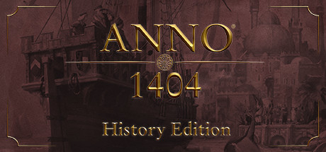

**Anno 1404 is the beloved city-builder set in the medieval Mediterranean where you develop Occidental and Oriental populations with intertwined production chains. Features detailed island economies, trade routes, and a satisfying supply chain optimization loop.**

---

## 📖 About

Anno 1404 is the beloved city-builder set in the medieval Mediterranean where you develop Occidental and Oriental populations with intertwined production chains. Features detailed island economies, trade routes, and a satisfying supply chain optimization loop.

## ⚠️ Problems Without Trainer

| Problem | Status |
|---------|--------|
| **Production Chain Complexity** — Long chains from raw materials to luxury goods require careful planning | ✅ Solved |
| **Population Tier Requirements** — Advancing citizens requires meeting specific happiness and goods conditions | ✅ Solved |
| **Warehouse Management** — Setting up efficient warehouses to avoid production stalls is critical | ✅ Solved |
| **Naval Combat** — Military campaigns against computer opponents require dedicated warship fleets | ✅ Solved |

## ✅ Solution

The **Anno 1404 Trainer** solves all these issues by giving you complete control over the game.

## 🎯 Full Feature List

- Unlimited Resources
- God Mode / Invincibility
- Instant Skill Cooldown
- One-Hit Kill
- Freeze Game Timer
- Unlock All Items & Achievements
- Custom Speed Multiplier
- Save State Anywhere

## 🚀 Quick Start

1. **Disable Windows Defender** temporarily (trainer may trigger false positive)
2. Download the trainer from the button above
3. Launch Anno 1404
4. Run the trainer as Administrator
5. Activate desired cheats with hotkeys

## 💎 Free vs Paid

| Feature | Free | Pro |
|---------|------|-----|
| Basic God Mode | ✅ | ✅ |
| Unlimited Resources | ✅ | ✅ |
| All Advanced Cheats | ❌ | ✅ |
| Auto-Updates | ❌ | ✅ |
| Priority Support | ❌ | ✅ |

## 💻 Requirements

- Windows 10/11 (64-bit)
- Anno 1404 (any version)
- .NET Framework 4.8+
- DirectX 11+

## 🍎 macOS

macOS users can use our alternative tool:

## ⚖️ Legal

This trainer is for educational and single-player use only. Use responsibly.

---

